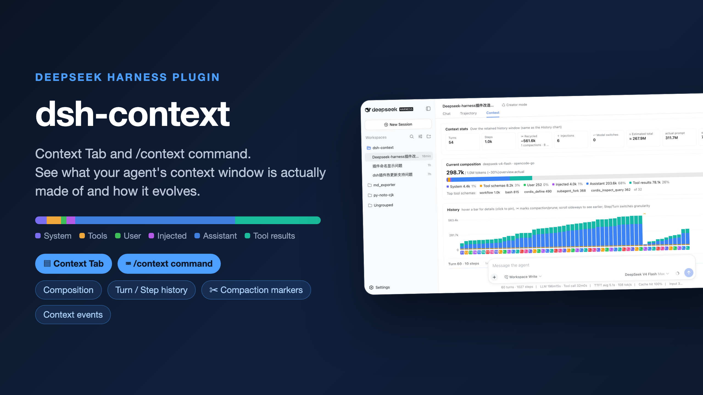

# dsh-context

[简体中文](https://github.com/bowenliang123/dsh-context/blob/main/README.md) · [English](https://github.com/bowenliang123/dsh-context/blob/main/README_en.md) · [日本語](https://github.com/bowenliang123/dsh-context/blob/main/README_ja.md) · [Español](https://github.com/bowenliang123/dsh-context/blob/main/README_es.md) · [Français](https://github.com/bowenliang123/dsh-context/blob/main/README_fr.md) · [Deutsch](https://github.com/bowenliang123/dsh-context/blob/main/README_de.md) · [Русский](https://github.com/bowenliang123/dsh-context/blob/main/README_ru.md) · [Português](https://github.com/bowenliang123/dsh-context/blob/main/README_pt.md)

[](https://www.npmjs.com/package/dsh-context)
[](https://github.com/bowenliang123/dsh-context)
[](https://dshfind.com/en/plugins/bowenliang123/dsh-context?ref=badge)

**Das beste [DeepSeek Harness-Plugin](https://www.deepseek.com/harness/) für Kontext-Einblicke und -Verwaltung deines Agents.**

> Empfohlen und mit einem Stern versehen von DeepSeek Harness-Mitarbeitern [@tianyicui](https://github.com/tianyicui) und [@turtle1999](https://github.com/turtle1999) — siehe [diesen Beitrag auf X](https://x.com/tianyi/status/2105256532657267119).

[`dsh-context`](https://www.npmjs.com/package/dsh-context) bietet umfassende Funktionen zur Verwaltung des gesamten Kontextlebenszyklus.
- **Kontext-Einblicke-Seite** — die sitzungsübergreifende Übersicht als eigenes Seitenleisten-Panel (neben Plugins und Automatisierungsaufgaben): KPI-Leiste mit 7-Tage-Token-/Kosten-Diagramm, Aktivitäts-Heatmap, aggregiertem Zusammensetzungsring und filterbaren Sitzungskarten, die direkt in jede Sitzung springen.
- **Kontext-Tab** — ein UI-Kontext-Dashboard für die Kontextstatistiken, Zusammensetzung, Trends, Ereignisse, Nachrichten und Befehle von DeepSeek Harness.
- **Flotten-Tab** — die eigene Seite der Agentenfamilie: der aktuelle Agent, seine Eltern und jeder Subagent als je eine Live-Karte.
- **Kontext-Panel** — dasselbe Dashboard als Tab in der rechten Seitenleiste: Wähle auf der Leitfadenseite der Seitenleiste **Kontext**, und das Panel öffnet sich neben dem Chat, inklusive Agentennetzwerk.
- **`/context`-Befehl** — der Slash-Befehl zeigt das Kontextmodell für die aktuelle Kontextzusammensetzung und die jüngste Kontextentwicklung.

▶️ **4-Minuten-Video-Tour** — [auf Bilibili ansehen](https://www.bilibili.com/video/BV1bn4K6TEEV/) (auf Chinesisch).

[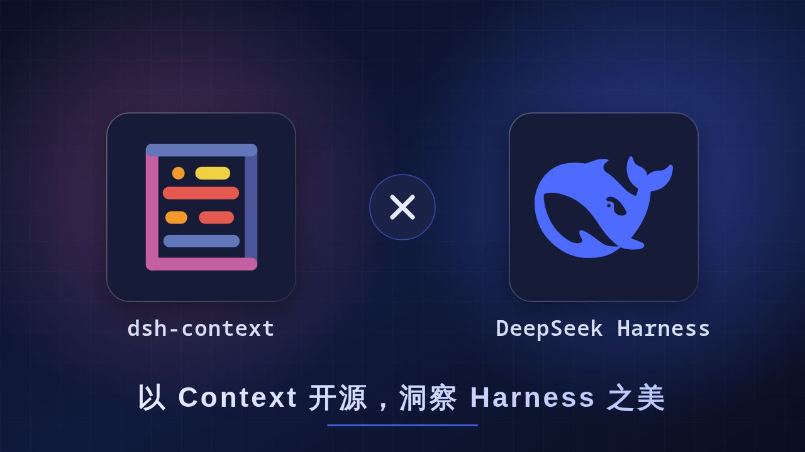](https://www.bilibili.com/video/BV1bn4K6TEEV/)

## Installation / Aktualisierung

### Auf DeepSeek Harness Web oder Desktop installieren

Gib `dsh-context` in das Suchfeld des Assistenten **Plugin hinzufügen** ein und klicke auf **Installieren**:


### Mit der `dsh`-CLI installieren

Installiere das Plugin [`dsh-context`](https://www.npmjs.com/package/dsh-context) aus [DeepSeek Harness](https://www.npmjs.com/package/@deepseek-ai/dsh):

```sh
dsh plugin --profile web add dsh-context
```

Oder aktualisiere das `dsh-context`-Plugin:

```sh
dsh plugin --profile web update dsh-context@latest
```

Starte dann die Web-UI mit `dsh web`. Kein Build-Schritt, kein Neustart.

## Verwendung

Fünf Oberflächen, eine Geschichte — was dein Agent mit sich trägt, wie es dorthin kam und was er damit gemacht hat:

| Ort | Was du bekommst |
| --- | --- |
| **Kontext-Einblicke-Seite** | Jede Sitzung auf einen Blick: Nutzung, Kosten, Cache-Treffer, tägliche Aktivität und Kontextprofile pro Sitzung — filterbar nach Bereich, Tag, Gruppe oder Suche, ein Klick zum Einspringen. |
| **Kontext-Tab** | Das vollständige Dashboard: Statistiken, Zusammensetzung, Trend pro Anfrage, Ereignisse, Dateiaktivität und Befehlsausführungen — in jeder Sitzung. |
| **Flotten-Tab** | Das Agentennetzwerk: der aktuelle Agent, seine Eltern und jeder Subagent, live. |
| **`/context`-Befehl** | Ein zentriertes Modal mit derselben Zusammensetzung und demselben Kontextbrowser, ohne den Chat zu verlassen. |
| **Einstellungen-Karte** | Benutzerbezogene Standards: Panel-Eintrag, Einblicke-Bereich, Trend- und Sortierstandards sowie System-Prompt-Präfix/-Suffix um jede Sitzung. |

## 🗂️ Die Kontext-Einblicke-Seite

Klicke in der Panel-Liste der Seitenleiste auf **Kontext-Einblicke** — dieselbe Zeilenebene wie **Plugins** und **Automatisierungsaufgaben** — und die Seite öffnet sich als vollflächiges Panel in der mittleren Spalte:

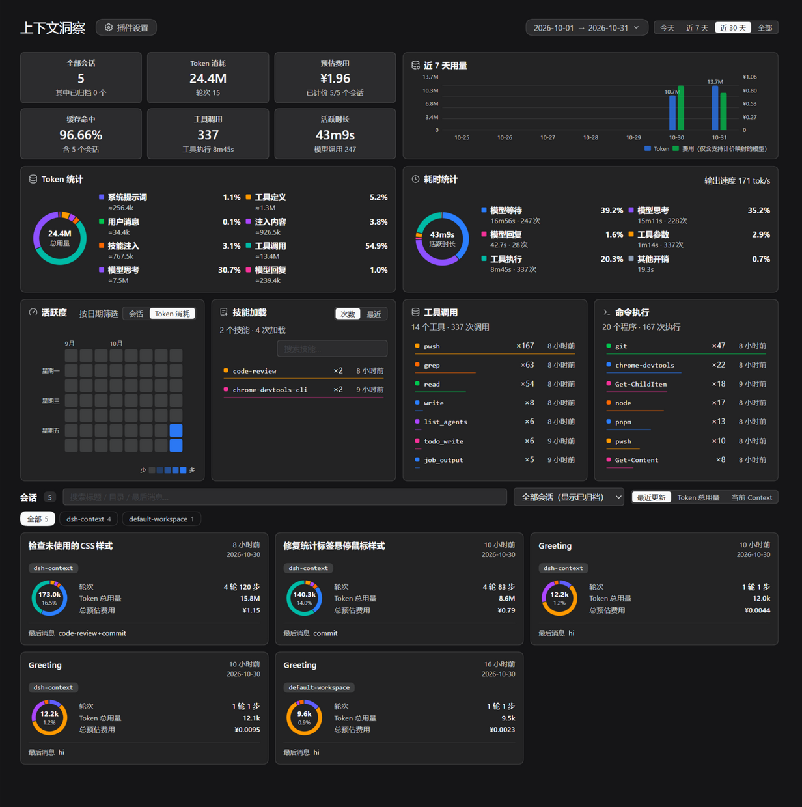

| Abschnitt | Die Frage, die er beantwortet |
| --- | --- |
| **KPI-Leiste** | Wie viel verbrauche ich — im gewählten Bereich (7T / 30T / alle) aktive Sitzungen mit abgerechneten Tokens, geschätzten Kosten, Cache-Trefferquote und Runden, gefaltet nach dem Tag, an dem jeder Schritt begann; Tool-Läufe und aktive Zeit umfassen diese Sitzungen und die gesamte Lebensdauer ihrer Subagenten und entsprechen der Zeitstatistik-Karte. |
| **7-Tage-Nutzungsdiagramm** | Wann habe ich was ausgegeben — die abgerechneten Tokens und geschätzten Kosten jedes der letzten 7 Tage als Balkenpaar, aggregiert nach dem Starttag jeder Anfrage in ihrer Sitzung (nicht dem Tag der letzten Aktivität der Sitzung). |
| **Aktivitäts-Heatmap** | Wann arbeite ich tatsächlich — die letzten 8 Wochen täglicher abgerechneter Tokens; klicke auf einen Tag, um die Sitzungen zu filtern und die drei Zählkarten auf diesen Tag zu begrenzen. |
| **Skill-Ladungen** | Welche Skills ich geladen habe, wie oft und wie kürzlich — die Ladevorgänge pro Skill im Bereich; klicke auf einen, um die Sitzungen zu filtern, die ihn geladen haben. |
| **Tool-Aufrufe** | Welche Tools liefen, wie oft und wie kürzlich — die Läufe pro Tool aus dem Tagesjournal; klicke auf eines, um die Sitzungen zu filtern, die es ausgeführt haben. |
| **Befehlsausführungen** | Welche Programme liefen, wie oft und wie kürzlich — die Befehlsausführungen pro Programm im Bereich, gezählt beim Dispatch; klicke auf eines, um die Sitzungen zu filtern, die es ausgeführt haben. |
| **Einstellungs-Eintrag** | Der Chip im Seitenkopf — derselbe geschützte Sprung zu den Einstellungen dieses Plugins wie die Plugin-Info-Karte im Kontext-Tab. |
| **Kontextzusammensetzung** | Wohin die abgerechneten Tokens des gewählten Bereichs gingen, aufgeteilt nach den abgerechneten Kategorien der Token-Karte (Tool-Aufrufe, Schlussfolgern, Antworten, …). |
| **Sitzungskarten** | Das Profil jeder Sitzung unter den vier Karten: Zusammensetzungsring, abgerechnete Tokens, Runden, Kosten und der Arbeitsbereichs-/Projekt-Breadcrumb — sortiert nach Aktualität, Tokens oder Kontextgröße, durchsuchbar, nach Arbeitsbereich gruppiert. Ein Klick auf eine Karte öffnet die Sitzung. |

## 📊 Der Kontext-Tab

Öffne eine beliebige Sitzung und klicke auf den Tab **Kontext**:

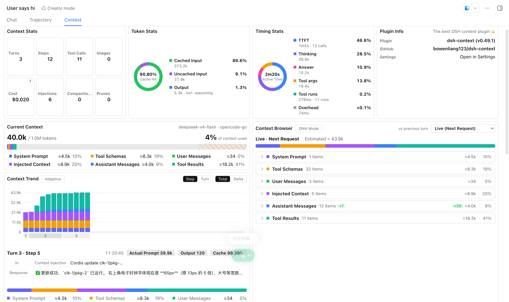

| Karte | Die Frage, die sie beantwortet |
| --- | --- |
| **Kontextstatistik** | Runden, Schritte, menschliche Eingaben, laufende Tool-Aufrufe — plus geschätzte Kosten aus den Listenpreisen von models.dev (fahre über das `?` für Preise pro 1 Mio.; nur DeepSeek unterscheidet Haupt-/Nebentarif: Die gelisteten Preise sind der Nebentarif, Haupttarif-Fenster werden mit 2× abgerechnet). |
| **Token-Statistik** | Wohin die abgerechneten Tokens gingen — dieselbe Summe wie die Chat-Statistikzeile unter dem Composer, aufgeteilt in System-Prompt, Tool-Schemas, Benutzernachrichten, injizierten Kontext, Skill-Injektionen, Tool-Aufrufe, Schlussfolgern und Antworten. Tool-Aufrufe fasst die Tool-Aufrufnamen und -Argumente (im Prompt wiederholt und in der Ausgabe erzeugt) mit den zurückgegebenen Ergebnissen zusammen; Antworten trennt den Antworttext des Modells aus demselben Assistenteninhalt und der Ausgabe; Schlussfolgern trennt dessen Denken auf dieselbe Weise; die Cache-Trefferquote der Sitzung steht in der Ecke. |
| **Zeitstatistik** | Wie sich die aktive Zeit auf Modellaufrufe, Tool-Ausführungen und Overhead verteilte. |
| **Aktueller Kontext** | Was sich *gerade jetzt* im Fenster befindet. |
| **Kontexttrend** | Die Größe jeder Anfrage — und ihre Geschichte. |
| **Kontextbrowser** | Woraus eine Anfrage *tatsächlich* zusammengesetzt wurde. |
| **Kontextereignisse** | Wann und warum sich das Fenster geändert hat. |
| **Dateiaktivität** | Was der Agent mit deinen Dateien *gemacht* hat. |
| **Befehlsausführungen** | Was der Agent ausgeführt hat, wie jeder Lauf endete und auf welche Programme er sich stützte. |

Die Kostenschätzung folgt einem dokumentierten Regelsatz: [Wie Modellpreise zugeordnet werden](docs/model-pricing-mapping.md).

Die Belegung und Zusammensetzung in der Kopfzeile lesen **dieselben offiziellen Token-Meter-Projektionen wie der Kontextring des Chat-Composers** (`contextPressure` / `contextBreakdown`), sodass die Zahlen immer mit dem übereinstimmen, was der Ring anzeigt — der Prozentsatz der Karte ist dieselbe Belegung, mit einer Nachkommastelle.

Die Agentennetzwerk-Zelle der **Kontextstatistik**-Karte (die abgerechneten Tokens und geschätzten Kosten der gesamten Familie) springt zum **Flotten**-Tab. Auch ihre Eingabe-/Ausgabe-Pills sind Sprunglinks: **Menschliche Eingaben** öffnet den **Kontextbrowser** auf deinen Nachrichten, und **Gelesen / Geschrieben / Durchsucht / Bilder** landen auf der **Dateiaktivität**-Karte mit der entsprechenden Art.

### Kontextstatistik

#### Token-Statistik und Zeitstatistik


#### Kontextstatistik


### 🧱 Aktueller Kontext — was jetzt im Kontextfenster ist

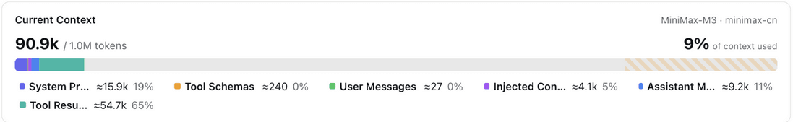

Ein sechsfarbiger gestapelter Balken gegen das volle Fenster des Modells (die beiden schraffierten Masken am Ende = Reserve der automatischen Komprimierung: ihr Puffer, dann das reservierte Ausgabefenster der Anfrage): System-Prompt, Tool-Schemas, Benutzernachrichten, injizierter Kontext, Assistentenantworten, Tool-Ergebnisse — jeweils mit ≈Token-Zahl und Anteil. Wenn eine Unterhaltung zu verschlechtern beginnt, siehst du hier, *welcher Teil* dafür verantwortlich ist.

### 📈 Kontexttrend — wie der Kontext pro Runde oder Schritt wuchs und sich entwickelte

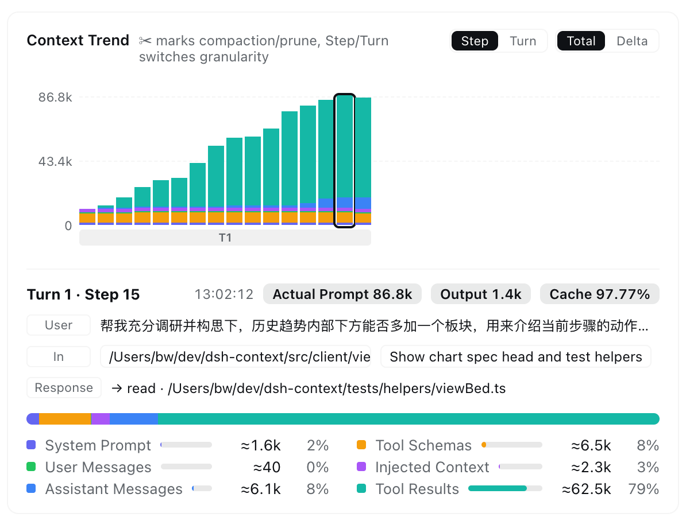

Ein gestapelter Balken pro Modellanfrage — feiner als pro Nachricht —, sodass du das Fenster Runde für Runde wachsen siehst:

- **✨ Schritt-Kurzfassung** — drei Zeilen in Alltagssprache unter dem Diagramm: **Benutzer** erinnert an die Nachricht, die die Runde eröffnet hat, **Eingang** listet, was neu hineinkam (meist die vorherigen Tool-Ergebnisse), **Antwort** zeigt die Antwort und/oder aufgerufene Tools. Klicke auf eine Zeile, um genau diese Nachricht im Kontextbrowser zu öffnen.
- **✂ markiert die Ereignisse** — Komprimierungen und Bereinigungen sind am jeweiligen Balken markiert, sodass sich die Einbrüche selbst erklären.
- **Lies es auf deine Weise** — Granularität **Schritt / Runde**, **Gesamt** (kumulative Zusammensetzung) oder **Delta** (die vorzeichenbehaftete Änderung jeder Anfrage) und seitliches Scrollen durch die ganze Sitzung. Im Delta-Modus stapelt sich Wachstum über der Basislinie, und eine Komprimierung taucht darunter:

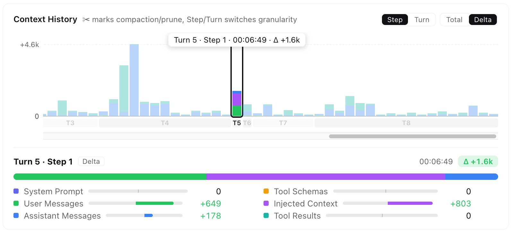

- **Übersicht** — ein Schalter quetscht die ganze Sitzung (Schritte oder Runden) in die Breite des Bereichs als durchgehendes gestapeltes Band: jeder Komprimierungseinbruch und jede Verschiebung der Zusammensetzung auf einen Blick, kein seitliches Scrollen, nichts zusätzlich zu laden. Markierungen zeigen die Quartile und die volle Spanne; zum Lesen darüberfahren, über ein Band fahren, um diese Kategorie im ganzen Band hervorzuheben; Klick fixiert den Schritt und öffnet die Kategorie des Bands im Browser (nicht kombinierbar mit DNA-Modus und Adaptiv).
- **Hover & Fixieren** — für einen sofortigen Tooltip darüberfahren; klicken, um die vollständige Aufschlüsselung zu fixieren, mit vom Anbieter gemeldeten **tatsächlichen Prompt / Output / Cache** neben den Schätzungen.
- **Live-Verknüpfung** — beim Überfahren eines Balkens wird der zusammengesetzte Kontext dieses Schritts im Kontextbrowser neben dem Diagramm angezeigt; beim Verlassen des Diagramms kehrst du zu deiner eigenen Auswahl zurück.

### 🧭 Kontextbrowser — öffne die Box jeder Anfrage

Wähle **Live (nächste Anfrage)** oder einen beliebigen aufbewahrten Schritt und durchstöbere, woraus diese Anfrage zusammengesetzt wurde: sieben einklappbare Kategorien entfalten sich zu einer Zeile pro Element mit seinem Token-Preis, und jedes Element entfaltet sich erneut zu seinem **tatsächlichen Inhalt** — dem System-Prompt, dem JSON-Schema jedes Tools, Nachrichtentext, Schlussfolgern, Tool-Argumenten und Tool-Ausgaben. Skill-Inhalte (der Katalog verfügbarer Skills, `/skill`-Aufrufe und `skill`-Tool-Ladungen) haben ihre eigene Kategorie **Skill-Injektionen**, sodass sich der Kontext-Fußabdruck eines heimlichen Skills nicht in den Töpfen für injizierten Kontext und Tool-Ergebnisse verstecken kann.

- **Wer welches Tool bereitstellt** — jede Tool-Schema-Zeile trägt einen Best-Effort-Quellen-Chip: `tool-*`-First-Party-Pakete, `dsh-*`-Fähigkeitspakete, `mcp:<server>`-Proxys oder das exakte Plugin, das live aus `tools.register()` beobachtet wird. Sortiere nach **Größe / Name** und filtere jede Kategorie nach ihren eigenen durchsuchbaren Feldern:

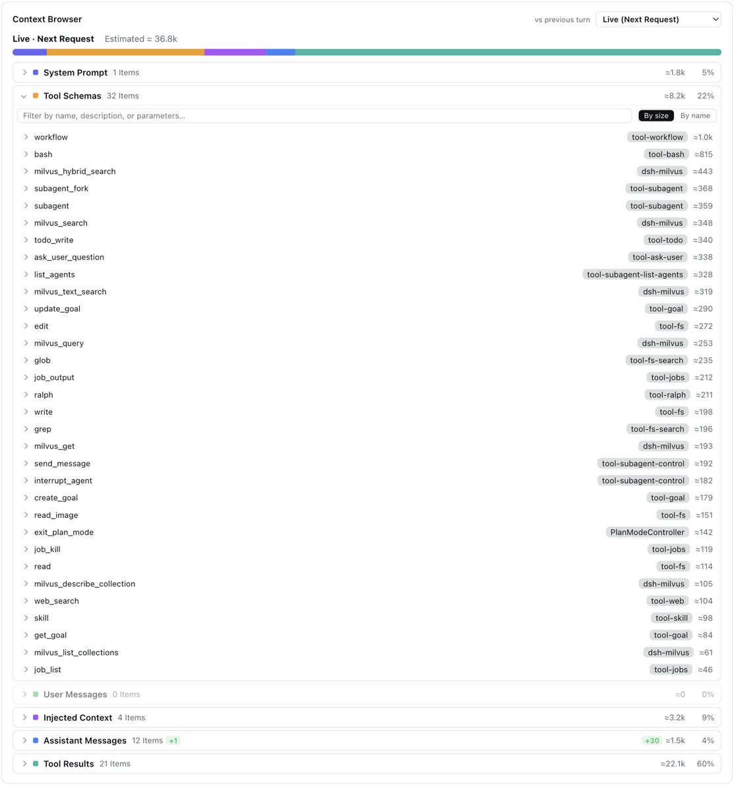

- **Assistentenantworten nach Art filtern** — das Suchfeld der Assistenten-Kategorie trägt Chips **Schlussfolgern / Tools / Antwort**, die jeweils die Antworten dieser Art in den aktuellen Suchergebnissen zählen (eine Antwort kann mehrere tragen); klicke auf einen, um nur die passenden Antworten zu behalten, und erneut, um ihn zu entfernen:


- **Tool-Ergebnisse öffnen sich zum vollständigen Aufruf** — der Tool-Name und die Argumente mit ihrem **OK/Fehler**-Status, der Ergebnistext mit Zeilenanzahl und einem Umschalter **Roh / Markdown**:

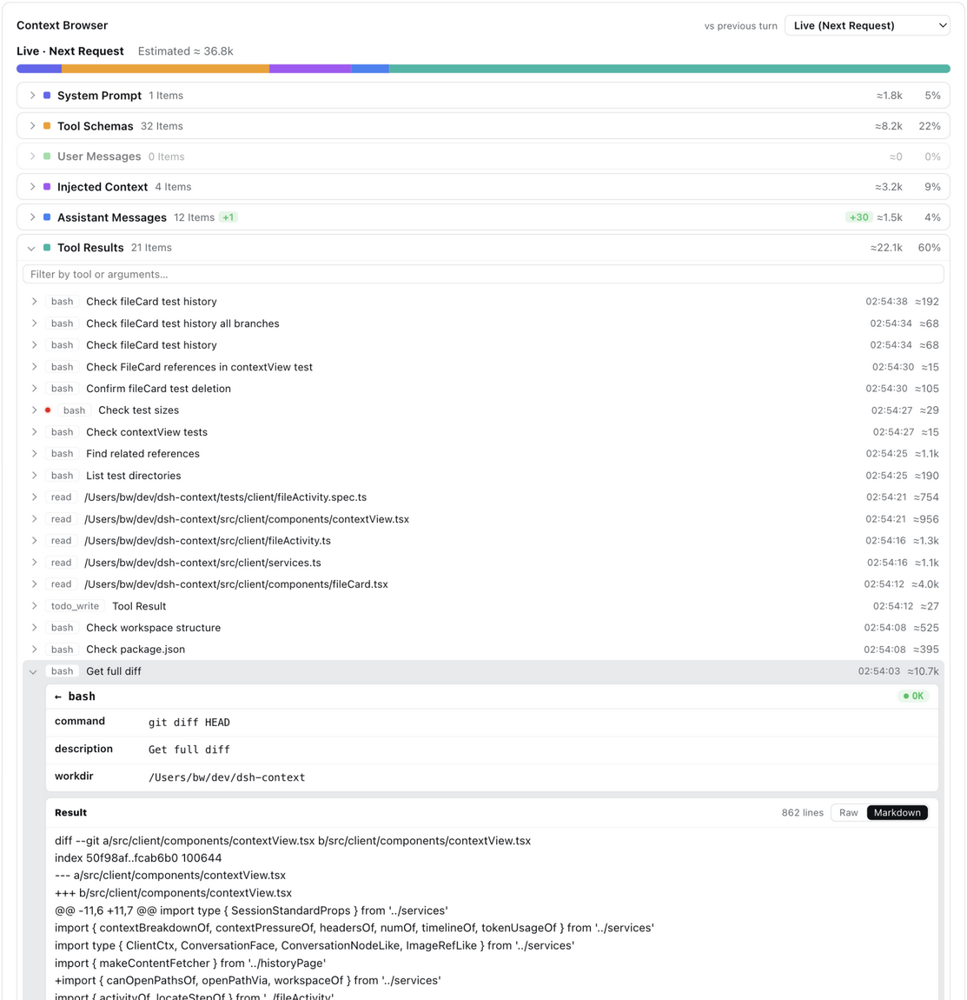

- **Anhänge werden als geordnete Karten gerendert** — die `image`- und `file`-Blöcke einer Nachricht stehen zusammen in der Reihenfolge, in der die Nachricht sie trägt, je eine Karte: Bilder mit Vorschaubild sowie Abmessungen, gespeicherter Größe und der offiziellen DeepSeek-Bildtoken-Schätzung; andere Dateien mit ihrem Typ-Glyph, ihrer Erweiterung und gespeicherten Größe. Ein Klick öffnet den Anhang in der eigenen Vorschauspalte von dsh (Markdown-, Code-, PDF-, Office- und Bildbetrachter) unter dem echten Dateinamen:

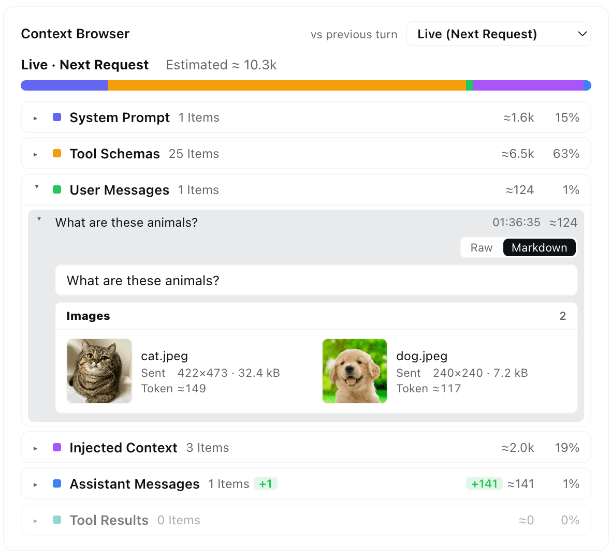

- **Diff gegen die vorherige Runde** — vorzeichenbehaftete Delta-Badges pro Kategorie (`+N` Elemente, `±Nk` Tokens) zeigen auf einen Blick, was eine Runde hinzugefügt oder zurückgewonnen hat. Schritte, die älter als eine Komprimierung sind, werden aus dem Archiv entfernter Nachrichten rekonstruiert — und die Karte sagt es, wenn die Zusammensetzung eines Schritts nur ungefähr ist.

- **Der DNA-Modus legt den ganzen Kontext flach aus** — der Balken zeichnet ein Band pro Element in der Lesereihenfolge des Modells, und darunter werden dieselben Elemente zu einer flachen Liste mit der neuesten Nachricht oben (das Modell liest älteste zuerst, daher läuft die Liste diese Reihenfolge von unten nach oben): jede Zeile trägt ihre Prompt-Position (`#12`), Kategorie, einführenden Schritt und Token-Preis und entfaltet sich zum selben vollständigen Inhalt; die Tool-Schemas und der System-Prompt schließen die Liste als zwei Gruppenzeilen ab. Die Karte endet bündig mit den Zusammensetzungs- und Trendkarten daneben — eine vollständig abgeflachte Sitzung scrollt intern, statt die Seite zu fluten.

### ⚡ Kontextereignisse — wann und warum sich das Fenster geändert hat

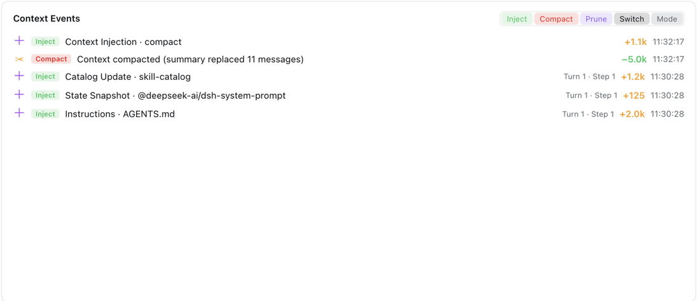

Jede Injektion, Komprimierung, Bereinigung, jeder Modellwechsel und jede Planmodus-Umschaltung — beschriftet mit ihrem Erzeuger (Anweisungsdatei, Plugin-ID, Skill-Name), ihrem Netto-Token-Delta (Komprimierungen zeigen, was sie zurückgewonnen haben), Runde/Schritt und Zeit. Die Chips **Injektion / Komprimieren / Bereinigen / Wechsel / Modus** filtern das Protokoll nach Art, jeder mit der Ereigniszahl der ganzen Sitzung.

### 📁 Dateiaktivität — was der Agent mit deinen Dateien gemacht hat

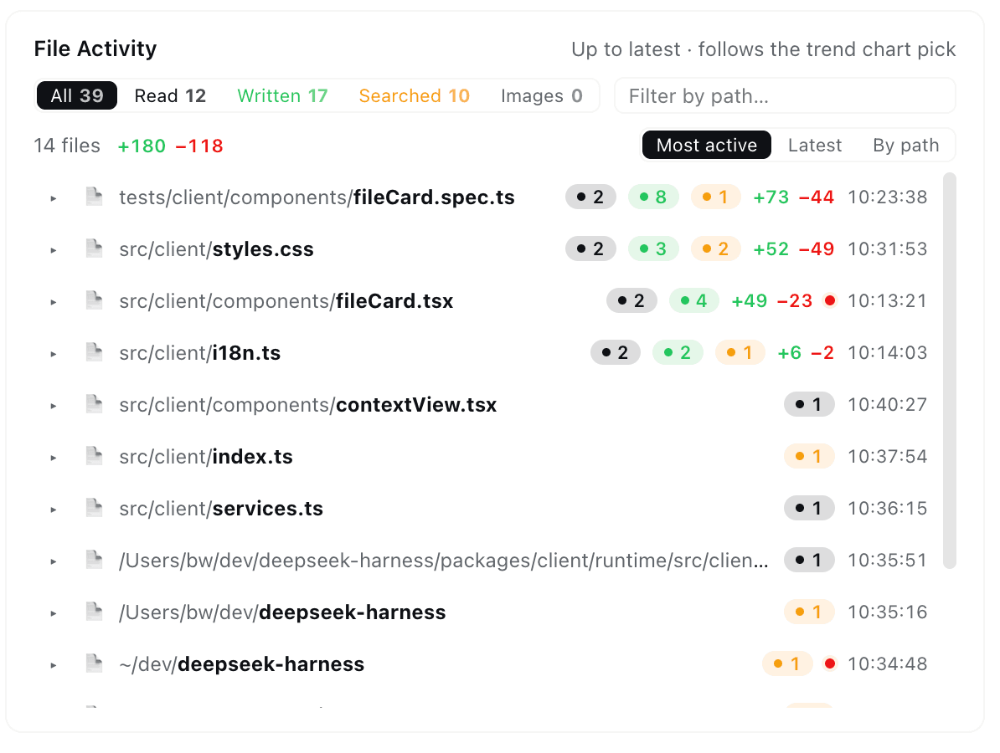

Eine Zeile pro berührter Datei — gelesen, geschrieben oder durchsucht — aggregiert bis zu dem Schritt, den du im Trenddiagramm wählst:

- **Zählungen pro Zweck** mit Header-Chips, die zugleich Filter sind (**Gelesen / Geschrieben / Durchsucht / Bilder**), und einem Pfad-Suchfeld.
- **Zeilen-Deltas** — jeder `edit`/`write` trägt seinen geschätzten `+hinzugefügt / −entfernt`-Fußabdruck bei, pro Datei und summiert.
- **Jeder Modus zählt** — native Tools, der `str_replace_editor` des Minimal-Presets und die verschachtelten Aufrufe in PTC-`run_code`-Programmen werden alle in Zeilen pro Tool gefaltet.
- **Suchen landen auf echten Dateien** — passende Dateien erhalten eigene Vorgangszeilen mit Trefferzahlen.
- **Klicke auf eine Zeile**, um ihr vollständiges Vorgangsprotokoll aufzuklappen — jeder Vorgang springt direkt zum exakten Tool-Ergebnis im Kontextbrowser.
- **Klicke auf einen Dateinamen**, um seine Vorschau in der rechten Seitenleiste zu öffnen, genau wie die integrierte Dateien-Seitenleiste — derselbe Betrachter, dasselbe Verhalten mit einem Tab pro Datei. Auf einem Harness ohne diese Spalte öffnet sich der Name wie bisher auf deinem System.

### 🖥️ Befehlsausführungen — was der Agent ausgeführt hat


Jeder Shell- und Code-Lauf mit Status, Wandzeit und Schrittstempel, plus einer Sitzungszusammenfassung, Aufmerksamkeits-Shortcuts und einem Programm-Ranking. Die Aufmerksamkeitsfakten und das Ranking bleiben sitzungsweit, während Suche und Status-Chips die Liste eingrenzen. Jeder Klick in der Leiste schreibt seine Linse in das Suchfeld — ein Programm-Klick füllt das Programm ein und hebt es hervor, ein weiterer Klick löscht beides —, sodass das Feld immer zeigt, was die Liste filtert.

## 🚢 Der Flotten-Tab

Öffne eine beliebige Sitzung und klicke auf den Tab **Flotte** (rechts von **Kontext**) — die Agentenfamilie auf einer eigenen Seite: eine Zusammenfassungsleiste, die Karten **Agentennetzwerk** und **Agentenübergreifende Zusammenarbeit**, darunter **Teamarbeitsaufgaben** und **Ereignisprüfung**.

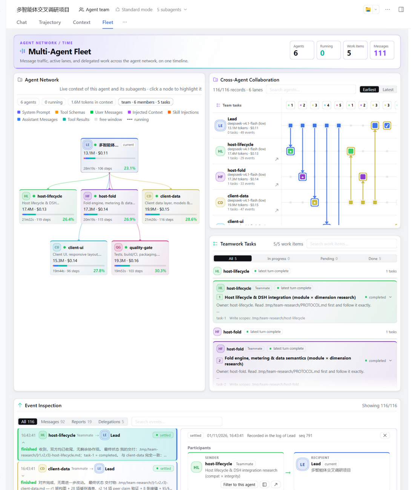

Die Zusammenfassungsleiste zählt Agenten, laufende Agenten, Arbeitselemente und Nachrichten. Wählst du einen Agenten im Diagramm oder in einer Spur, grenzt sich die Zusammenarbeitsansicht auf diesen Agenten ein, sodass die Seite jeweils für ein Mitglied antwortet.

### 🕸 Agentennetzwerk — das Familienporträt

Der aktuelle Agent, seine Eltern und jeder Subagent — eine Karte pro Agent: sein Titel, Live-Kontextgröße und Fensterbelegung, ein Zusammensetzungsbalken und wie lange er läuft und wie viele Schritte er gemacht hat. Kanten fächern sich von jedem Elternteil in der Farbe der Linie auf — fahre über eine Karte, um ihre ganze Kette hervorzuheben und die vollständige Aufschlüsselung im Detailstreifen zu lesen; klicke auf einen Knoten, um ihn hervorzuheben. Laufende Agenten atmen mit einem grünen Puls auf ihrer eingehenden Kante und drehen den rollenden Spinner des Harness neben ihrem Titel, der sich in denselben grünen Punkt setzt, den die Subagentenliste des Headers verwendet, sobald die Arbeit erledigt ist; schmale Bereiche falten die Familie in ordentliche Zeilen — nie eine horizontale Scrollleiste.

### 🛰 Agentenübergreifende Zusammenarbeit — die Familie auf einer Zeitachse

Jeder Agent erhält eine Spur auf einer gemeinsamen Zeitachse: Nachrichten zwischen Agenten, Markierungen für Teamaufgaben und Delegationsdatensätze, wobei ruhige Spuren hinter einem Schalter eingeklappt werden. Aufgabennummern kennzeichnen eine Aufgabe über Spuren hinweg — wiederholte Nummern sind dieselbe Aufgabe — und beim Überfahren werden zusammengehörige Datensätze verknüpft. **Earliest / Latest** kehrt die Reihenfolge um, das Suchfeld grenzt die Spuren ein, und ein Klick auf eine Aufgabe filtert die Zeitachse und deckt sie auf.

### ✅ Teamarbeitsaufgaben — wer macht was

Das Board **Teamarbeitsaufgaben** vereint Teamaufgaben und Subagenten-Delegationen — Besitzergruppen, Statusfilter (Alle / In Bearbeitung / Ausstehend / Erledigt) und Blockiert-von-Verknüpfungen, die die ganze Voraussetzungskette hervorheben, wenn du eine Aufgabe fokussierst. Jede Karte trägt Besitzer, Kurzbeschreibung, Schreibbereiche und Abschlussantwort; ein Klick auf eine Aufgabe öffnet ihre vollständige Beschreibung an Ort und Stelle, roh oder gerendert.

### 📡 Ereignisprüfung — wer was zu wem gesagt hat

Die Karte **Ereignisprüfung** liest die Sitzungsprotokolle der Familie automatisch — kein Scan-Schritt. Nachrichten, Berichte und Delegationsdatensätze fließen in einen filterbaren Strom: Wähle einen Zeitachsenknoten oder einen Stromdatensatz, um den vollständigen Datensatz zu sehen — das Sitzungsprotokoll, aus dem er stammt, und seine Sequenz, einen Hinweis, wenn die Laufzeit den Abschluss statt des Kindes geschrieben hat, den vollständigen Abschlussbericht (mit strukturiertem Ergebnis oder Diagnose) und Teilnehmerkarten, die den Chat dieses Agenten in der Seitenleiste oder der ganzen Ansicht öffnen. Filtere nach Art oder Text, und die gemeinsame Agentenauswahl grenzt den ganzen Hub ein.

Das **Kontext**-Panel der rechten Seitenleiste behält dieselbe Familienkarte inline, sodass die Familie beim Lesen des Chats nur einen Klick entfernt bleibt. Du willst den Tab gar nicht? Schalte **Flotten-Tab** in der Einstellungen-Karte aus — die Karte lebt dann in diesem Panel weiter, und die Familienzelle des Kontext-Tabs öffnet sie dort, wann immer eine Seitenleiste bereitgestellt wird.

## ⌨️ `/context`-Befehl

Tippe `/context` (oder wähle es aus dem `/`-Menü) und drücke Enter:

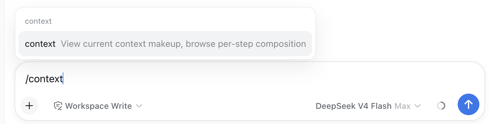

Ein zentriertes Dialogfenster öffnet sich mit der Karte **Aktuelle Zusammensetzung** und dem **Kontextbrowser** — derselbe Zusammensetzungsbalken, dieselbe Schrittauswahl und dieselben `vs previous turn`-Diff-Badges wie im Tab:

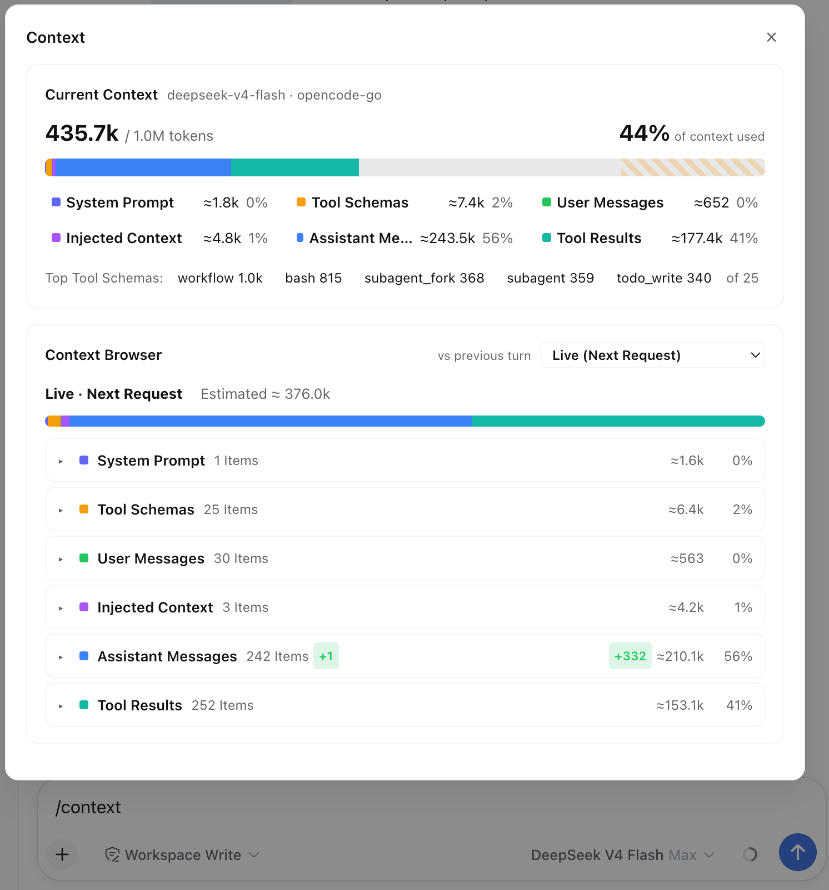

## ⚙️ Einstellungen

Die Einstellungen-Karte **Kontext** enthält die benutzerbezogenen Einstellungen dieses Plugins — den **Eintrag des Kontextbereichs** (der **Kontext**-Tab im Gespräch, das Panel der rechten Seitenleiste, beides oder Ausblenden für keines — der Sprung aus der Antwortzeile geht mit), den eigenen Anzeigen/Ausblenden-Schalter des **Flotten**-Tabs (der Panel-Eintrag steuert ihn nie), den Standardbereich von **Kontext-Einblicke** (Heute / Letzte 7 Tage / Letzte 30 Tage / Alle, standardmäßig Letzte 30 Tage; das Wählen einer Voreinstellung auf der Seite schreibt sie zurück), die Trend-Granularität (Schritt/Runde), den Trendmodus (Gesamt/Delta), die Dauerkurve des Trends (standardmäßig angezeigt), die Schwelle für die automatische Trendübersicht, die Diff-Basis des Kontextbrowsers, die Sortierung von Tools und Dateiaktivität und den Anzeigen/Ausblenden-Schalter von Kontext-Einblicke. Sie lebt auf der **Plugins**-Seite: Seitenleisten-Eintrag **Plugins** → Seite des **dsh-context**-Bundles → dessen Abschnitt **Konfiguration** (die Karte wird vom Live-Konfigurationsformular des Eintrags bereitgestellt).

Die Zeilen **System-Prompt · Präfix / Suffix** enthalten freien Text, der ganz am Anfang / Ende des System-Prompts jeder Sitzung angehängt wird, für alle Agenten (auch Subagenten) — eine Persona oder Verhaltensregel pro Deployment, die die eigene Prompt-Zusammensetzung des Harness nutzt. Änderungen gelten ab der nächsten Runde; lasse eine Zeile leer, um sie zu deaktivieren.

Die Voreinstellungs-Schaltflächen von Kontext-Einblicke schreiben die Auswahl als gespeicherten Standard zurück; jeder andere Schalter im Diagramm und in den Karten bleibt ansichtsspezifisch und überschreibt die gespeicherte Einstellung nie.

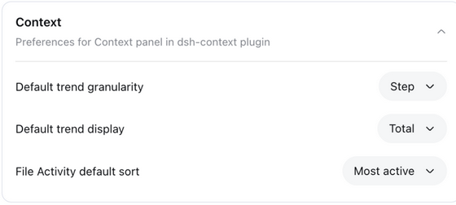

## Gut zu wissen

- **Cache-Fußabdruck** — das Plugin speichert nur eine kompakte Zusammenfassung pro Sitzung (Zusammensetzung, Zählungen, Kosten/Zeit, Modellinfo) im Projektions-Cache von dsh; die schweren Details pro Ereignis (Oberflächentext, Anfrageaufschlüsselungen, Dateivorgänge, Befehlprogramme, Spannen) werden bei Bedarf aus dem dauerhaften Protokoll neu gefaltet, sodass der Cache auch bei langen Sitzungen klein bleibt. Detailansichten sind begrenzt (Schritte 1500 · Runden 300 · Ereignisse 400 · Oberflächenknoten 2000 · Archiv 400 · Dateivorgänge 400 · Befehle 400).
- **Schätzungen vs. Ist-Werte** — Kategoriezahlen verwenden die eigene Heuristik fester Dichte von dsh (dieselbe wie sein integrierter Token-Meter); die fixierten Trenddetails zeigen die vom Anbieter gemeldeten Ist-Werte daneben, und die Token-Karte paart ihre ≈-geschätzten Zusammensetzungsanteile mit der anbieter-exakten abgerechneten Summe.
- **Kompatibilität** — funktioniert mit `@deepseek-ai/dsh` ab **0.2.0-rc.2** (die Linien `0.2.0` und `0.2.1` verifiziert auf ihren rc.2-Releases, die Linie `0.2.2` auf ihrem rc.1-Release), der V4-Sitzungsprotokoll-Generation, aus einem einzigen formgesteuerten Codepfad. Die Matrix pro Release und wie sie verifiziert wird: [docs/compatibility.md](docs/compatibility.md).
- **I18n** — UI in 简体中文, English, 日本語, Español, Français, Deutsch, Русский und Português (Sprachwechsel erfordert dsh 0.2.2+; frühere unterstützte Linien bieten nur Chinesisch und Englisch).

## Gefällt es dir?

Wenn `dsh-context` dir geholfen hat zu verstehen, was dein Agent mit sich herumträgt, ist ein ⭐ auf [GitHub](https://github.com/bowenliang123/dsh-context) sehr willkommen — und Issues/PRs sind willkommen!

## Lizenz

[Apache-2.0](https://www.apache.org/licenses/LICENSE-2.0)
